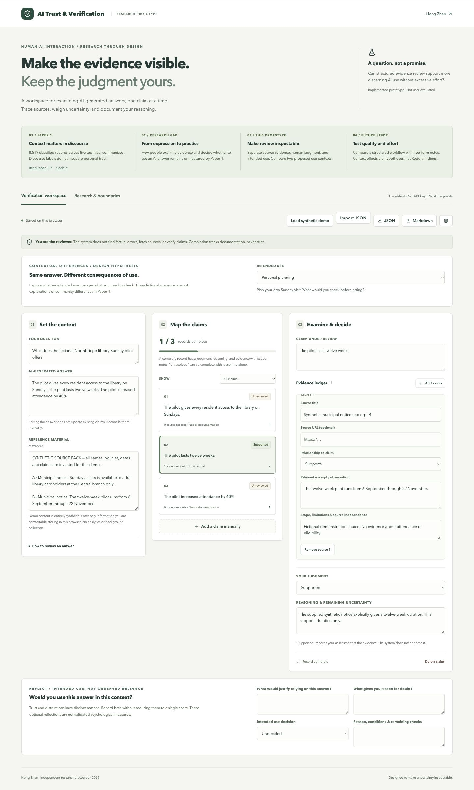

# AI Trust & Verification
### An Interactive Research Prototype

**Inspect the evidence. Keep the judgment yours.**

A human-led workspace for reviewing AI-generated informational answers, designed and implemented as an independent HCI research prototype by **Hong Zhan** in 2026.

**Status:** functioning prototype; no user study conducted. No automatic fact checking, validated trust intervention, or demonstrated improvement in decision quality is claimed.

[Launch demo](https://ivyhongzhan.github.io/ai-trust-verification/) · [Research rationale](docs/RESEARCH_RATIONALE.md) · [Proposed study](docs/STUDY_PROTOCOL.md) · [Implementation guide](docs/IMPLEMENTATION.md) · [Verification report](docs/VERIFICATION.md)



## Paper 1 → Research gap → Prototype → Future study

| Stage | What it establishes / asks |
| --- | --- |
| **Paper 1** | Community- and time-stratified trust/distrust discourse differs within the released corpus. Labels characterize records, not people’s attitudes or behavior. |
| **Research gap** | The archive does not show how people verify AI answers, handle conflicting evidence, or decide whether use is warranted in a particular context. |
| **Interactive prototype** | Make evidence, source limits, trust/distrust considerations, and intended use visible in an editable record. |
| **Future empirical study** | Test judgment quality and effort against free-form notes; explore differences between personal planning and public communication. |

The two implemented task contexts reuse the same synthetic evidence but change the intended use. They are **design hypotheses**, not findings about Reddit communities. Choosing a context does not change what is true. Evidence judgments, trust/distrust reflections, and intended-use decisions remain separate. A stated intention is not observed reliance, and no “appropriate reliance” score is computed.

## The research question

**How does a claim–evidence workspace, compared with an answer and free-form notes, affect the quality of evidence-grounded judgments and the effort of reviewing AI-generated informational answers?**

The goal is discerning review, not maximizing trust. This project makes that question testable through a working interface and an executable study proposal; it does not yet answer it.

## Try it in two minutes

1. Open the demo: no account, model service, or API key is required. All example policies, names, claims and excerpts are synthetic.
2. Select the first claim: “every resident” is broader than the source pack’s “adult library cardholders at the Central branch only.”
3. Add a source with the relevant excerpt, select **Challenges**, and describe what that source does and does not establish.
4. Record your judgment and reasoning. Try **Unresolved** for a claim you cannot settle.
5. Export JSON to restore your workspace later, or Markdown to share a readable record. Edit and revisit any judgment.

The prefilled duration claim illustrates a documented record; it is not an automated system verdict. Completing a record changes documentation progress only. A citation, a filled form, or a “Supported” judgment does not prove a claim is true.

## Implemented features

- Editable question, original AI answer, and optional reference material.
- Manual claim creation, selection, editing and deletion; no unsupported automatic extraction.
- Multiple sources per claim, with supporting/challenging/context relations, excerpts and scope notes.
- Human-authored judgments: unreviewed, supported, contradicted, mixed evidence and unresolved.
- Documentation progress, incomplete/complete filtering, and per-claim modification timestamps in exports.
- Browser-local persistence with visible storage-failure feedback; JSON import/export and Markdown export.
- Malformed import rejection, size limits and safe HTTP(S) source links.
- Two explicit use contexts, separate trust/distrust reflections, and a revisitable intended-use decision.
- Responsive workspace, native confirmation dialog, visible focus states, labeled controls, and research brief.
- Deterministic synthetic demo with fully inspectable source pack.

## Research foundations and boundaries

The project follows a separate direction from Zhan’s *Beyond the Aggregate: Trust and Distrust in Generative AI Across Technical Reddit Communities and Time* ([preprint](https://papers.ssrn.com/sol3/papers.cfm?abstract_id=7671698), [repository](https://github.com/ivyhongzhan/genai-trust-reddit-analysis)), under review at PACM HCI (CSCW) according to the author. That study describes released trust discourse across five technical Reddit communities, including 8,519 valid classification records; it does not directly measure users’ trust, reliance, or verification behavior. Its separate dimension archive, sampling and measurement limitations remain separate from this project. The original data and repository were not changed.

Primary design references include [Buçinca, Malaya & Gajos (2021)](https://doi.org/10.1145/3449287), [Bansal et al. (2021)](https://doi.org/10.1145/3411764.3445717), and [Amershi et al. (2019)](https://doi.org/10.1145/3290605.3300233). These motivate testing deliberation costs, evaluating actual decisions, and disclosing capabilities. They do not establish this interface’s effectiveness. Full evidence-to-design reasoning and limitations appear in the [rationale](docs/RESEARCH_RATIONALE.md).

## Proposed evaluation

A 6–8 person formative phase would examine workflow fit and misunderstanding. A later preregistered randomized comparison would contrast this workspace with matched answer-plus-notes materials. Both arms would use an identical final-response form and fixed source packs. Blinded coders would assess evidence-grounded judgment quality; secondary outcomes include false acceptance, time, source use and perceived effort. Sample size requires a prospective power simulation. The comparator, study materials and instrumentation remain to be built; no ethics approval or participants are claimed. See [full protocol](docs/STUDY_PROTOCOL.md).

## Run locally

Requires Node.js **22.12+** (Node 22 LTS recommended) and npm.

```sh
npm ci
npm run dev
```

Open the local URL printed by Vite. For production:

```sh
npm run build
npm run preview
```

## Verification

```sh
npm test
npm run build
npx playwright install chromium
npm run test:e2e
npm audit --audit-level=high
```

The browser suite starts its own local server. Automated accessibility checks cover the workspace and mobile research brief; they do not establish full WCAG compliance. Actual counts, environment, fixes and remaining limits are documented in [the verification report](docs/VERIFICATION.md). CI repeats the checks before GitHub Pages deployment.

## Architecture

React + TypeScript + Vite; Vitest for the domain model; Playwright and axe-core for browser verification. Static deployment requires no server or database. Lucide supplies UI icons. Application state is a versioned `Review → Claim[] → Evidence[]` tree. Domain rules and serialization live separately from rendering. See the [owner-oriented implementation explanation](docs/IMPLEMENTATION.md) for code paths, validation rules and tradeoffs.

## Privacy and security

The app makes no AI requests, fetches no sources, and collects no analytics. Input stays in localStorage on the current browser/origin until you export or clear it. This is not encrypted storage; avoid secrets and shared-device use. External links navigate to third-party sites. Normal hosting requests are visible to the host. Imported text is rendered as text, never executable HTML; URLs are restricted to HTTP(S). Review exports for private information before sharing. No real personal or Reddit data are included.

## Limitations

- No empirical evidence yet that the workflow improves judgment or reduces overreliance.
- No automated source credibility, factuality, completeness, or coverage assessment.
- Users may omit difficult claims or enter shallow reasoning; completeness can be satisfied by low-quality text.
- Editing the original answer does not reconcile existing claims automatically.
- No collaboration, cloud sync, revision history, source archival, or source-removal undo.
- Browser persistence is not a backup; export records you wish to keep.
- Synthetic tasks and automated accessibility checks do not establish real-world usability.
- Research novelty requires broader comparison with verification and provenance workbenches.

## Authorship and AI assistance

Hong Zhan is the project owner and research applicant. OpenAI Codex assisted with implementation, documentation drafting, literature lookup and automated verification in November 2026. The project must not be described as unaided implementation, an evaluated HCI intervention, or a published empirical contribution. The owner should review the code and study protocol and be able to explain them before using this project in applications. No study results, participants, interviews or statistical findings were generated.

## License

Code and project documentation: [MIT](LICENSE). Third-party packages retain their own licenses. Cited papers are linked rather than redistributed. The separately referenced Reddit research project is governed by its own materials and licenses.
